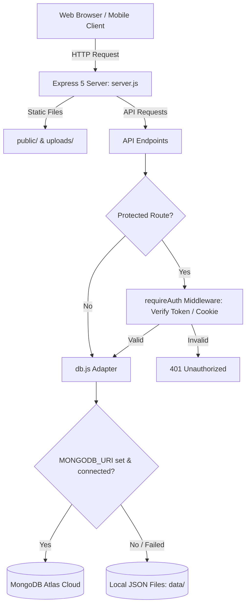

# 🏛️ System Architecture

## 1. Directory Structure

```text
river dale/
├── context memory/               # 🧠 Complete project documentation and context
│   ├── README.md
│   ├── PROJECT_OVERVIEW.md
│   ├── ARCHITECTURE.md
│   ├── DATABASE_AND_STORAGE.md
│   ├── ADMIN_PANEL_AND_SECURITY.md
│   ├── SEO_AND_SCHEMA.md
│   ├── DEPLOYMENT_GUIDE.md
│   └── TIMELINE_AND_DECISIONS.md
├── data/                         # 📁 Local JSON database fallback
│   ├── admin.json                # Admin credentials, salt, and session tokens
│   ├── bookings.json             # Customer booking records
│   └── site-content.json         # CMS text, packages, photos, and Instagram feed
├── public/                       # 🌐 Client-side static assets
│   ├── admin/                    # Admin portal SPA (hidden from public UI)
│   │   ├── index.html
│   │   ├── admin.css
│   │   └── admin.js
│   ├── css/                      # Public site stylesheets
│   ├── js/                       # Public site scripts (booking modal, gestures, reviews)
│   ├── images/                   # Optimized WebP assets and SVG icons
│   └── index.html                # Main public landing page
├── scripts/                      # 🛠️ Utility scripts
│   ├── export-chat.js            # Chat transcript exporter
│   └── verify-seo.js             # Automated technical SEO validation script
├── uploads/                      # 🖼️ User-uploaded media via Admin CMS
├── .env                          # Local environment variables (gitignored)
├── .env.example                  # Template for production environment configuration
├── .gitignore                    # Git exclusions
├── db.js                         # 🗄️ Unified database adapter (MongoDB + JSON fallback)
├── package.json                  # Dependencies and npm scripts
├── PROJECT_CHAT_HISTORY.md       # Complete chat transcripts
└── server.js                     # 🚀 Express 5 server and API endpoints
```

---

## 2. Server Request Flow



---

## 3. Core API Endpoints

### Public Endpoints:
- `GET /` — Serves the primary landing page (`public/index.html`).
- `GET /api/content` — Retrieves dynamic site copy, packages, photos, and Instagram items.
- `GET /api/packages` — Fetches current kayaking tour packages and live pricing.
- `POST /api/bookings` — Submits a customer booking request with reference ID (`RDK-YYYY-XXXX`).

### Admin & CMS Endpoints (Protected by `requireAuth`):
- `POST /api/admin/login` — Verifies password against salted SHA-256 hash; generates 7-day session token.
- `POST /api/admin/logout` — Revokes session token and clears auth cookie.
- `GET /api/admin/verify` — Validates current session status.
- `POST /api/admin/change-password` — Updates password with newly computed salt & hash.
- `POST /api/upload` — Multi-part image uploader for hero, tours, gallery, and Instagram.
- `PUT /api/content` — Updates general website content.
- `PUT /api/content/photos` — Updates section photo URLs.
- `POST /api/content/instagram` — Adds an Instagram gallery photo.
- `DELETE /api/content/instagram/:id` — Removes an Instagram photo.
- `POST /api/packages` — Creates a new tour package.
- `PUT /api/packages/:id` — Edits package price, title, or details.
- `DELETE /api/packages/:id` — Removes a package.
- `GET /api/bookings` — Retrieves all bookings with query filters (`status`, `search`, `sortBy`).
- `PUT /api/bookings/:id` — Updates booking status or adds internal admin notes.
- `DELETE /api/bookings/:id` — Deletes a booking record.
- `GET /api/bookings/export` — Exports bookings as formatted CSV.
